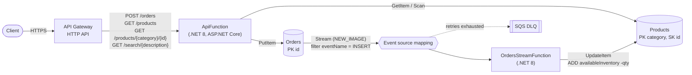

# AWS port: DynamoDB + Lambda + API Gateway

This is the AWS version of the Azure Functions + Cosmos DB retail demo in this repo. The original Azure code in [`../CosmosFunctionsDemo`](../CosmosFunctionsDemo), [`../infrastructure`](../infrastructure) and [`../pipelines`](../pipelines) is unchanged.

| Azure | AWS |
|---|---|
| Azure Functions v2, .NET Core 3.1 | AWS Lambda, .NET 8 (`dotnet8` managed runtime) |
| HTTP triggers | API Gateway HTTP API → one ASP.NET Core Lambda (`Amazon.Lambda.AspNetCoreServer`) |
| Cosmos DB `products` container (PK `/category`) | DynamoDB `Products` table (PK `category`, SK `id`) |
| Cosmos DB `orders` container (PK `/customerNumber`) | DynamoDB `Orders` table (PK `id`) |
| Change feed + `CosmosDBTrigger` + `leases` container | DynamoDB Streams (`NEW_IMAGE`) + Lambda event source mapping |
| Bicep + Azure DevOps | AWS CDK v2 in C# |

## Layout

```
aws/
├── CosmosAwsDemo.Aws.sln
├── src/CosmosAwsDemo.Lambda/          # Lambda code (both functions live in one assembly)
│   ├── LambdaEntryPoint.cs            #   API function handler (HTTP API payload v2)
│   ├── LocalEntryPoint.cs             #   same API on Kestrel for local runs
│   ├── OrdersStreamFunction.cs        #   stream function handler (replaces OrdersChangeFeedProcessor)
│   ├── Api/Startup.cs                 #   routes
│   ├── Data/                          #   ProductRepository, OrderRepository, InventoryUpdateService
│   └── Models/                        #   Product, Order, OrderLineItem (same JSON shape as the originals)
├── infrastructure/                    # CDK app (cdk.json + src/CosmosAwsDemo.Infrastructure)
├── migration/
│   ├── seed-dynamodb.sh               # seed/products.json -> Products, using aws dynamodb batch-write-item
│   └── cosmos_to_dynamodb.py          # generic Cosmos container -> DynamoDB table export/import
├── scripts/local-dynamodb.sh          # starts DynamoDB Local and creates both tables
└── tests/
    ├── CosmosAwsDemo.Tests/           # xUnit behavioral tests against DynamoDB Local
    └── smoke-local.sh                 # DynamoDB Local + seed script + API on Kestrel + curl checks
```

## Architecture



| Original function | AWS route / trigger | Implementation |
|---|---|---|
| `CreateOrder` (sync, `out` binding) and `CreateOrder2` (async, `IAsyncCollector`) | `POST /orders` → 204 | One async endpoint. `PutItem` (upsert, like the output binding). Generates an `id` if it's missing, like the binding does. |
| `GetProductByIdFromRoute` | `GET /products/{category}/{id}` → 200 / 404 | `GetItem` on `category` + `id` |
| `GetProducts` | `GET /products` → 200 | Paginated `Scan` (25 items per page, follows `LastEvaluatedKey`). Same as the original `ReadDocumentFeedAsync` loop. |
| `GetProductsByDescription` | `GET /search/{description}` → 200 | Paginated `Scan` with `FilterExpression` `contains(descriptionLower, :lower) OR contains(description, :raw)` |
| `OrdersChangeFeedProcessor` + `InventoryUpdateService` | Orders stream → `OrdersStreamFunction` | `UpdateItem` `ADD availableInventory :qty` with a negative quantity, conditional on `attribute_exists(id)` |

## DynamoDB design (access patterns first)

| Access pattern | Cosmos DB (original) | DynamoDB | Why |
|---|---|---|---|
| Get one product by category + id | Point read, `Id={id}`, `PartitionKey={category}` | `GetItem` on Products (`category`, `id`) | Same composite identity. Cosmos ids are unique only within a partition, so `category` + `id` is the natural PK + SK. |
| List the whole catalog | `ReadDocumentFeedAsync` (cross-partition read feed) | `Scan`, paginated | "Every item" isn't a key condition. A `Query` would need one fixed partition value for all products, which creates a hot partition and gives nothing a Scan doesn't. For a catalog-sized table, a paginated Scan is the right tool. |
| Substring search on description | `SELECT * FROM c WHERE CONTAINS(c.description, @d, true)` (cross-partition scan) | `Scan` + `FilterExpression contains(...)` | DynamoDB has no substring index. Cosmos also scans every document for this query. Note that `FilterExpression` is applied after the read, so you pay RCUs for the whole table, the same as the Cosmos RU cost. |
| Write an order | Output binding upsert into `orders` (PK `/customerNumber`) | `PutItem` on Orders (PK `id`) | Every order access is by `id`. Nothing queries by customer. |
| React to new orders | Change feed on `orders` | DynamoDB Stream on Orders (`NEW_IMAGE`) | See below. |
| Decrement inventory | `ReadDocumentAsync` → `-=` → `UpsertDocumentAsync` | `UpdateItem ADD availableInventory :negQty` | A single atomic server-side update. There's no read-modify-write race. `ConcurrentOrders_DecrementAtomically` checks this with 25 parallel invocations. |

### Case-insensitive search: `descriptionLower`
The original query passes `true` as the third `CONTAINS` argument, which makes the match **case-insensitive** (`/search/HOODIE` finds "Cognition hoodie"). DynamoDB's `contains()` is case-sensitive. To keep the same behavior, `seed-dynamodb.sh` and `cosmos_to_dynamodb.py --lowercase description` also write `descriptionLower`, and the filter matches the lower-cased search term against it. Items written without `descriptionLower` still match, but case-sensitively, through the `OR contains(description, :raw)` branch. If something else writes products, have it set `descriptionLower` too.

### Documented alternative: keyword-token GSI (not deployed)
If search must avoid a full Scan, write one extra item per lower-cased word in the description, for example `{category: "TOKEN#hoodie", id: "Apparel#COG-001"}` in the same table or in a `ProductTokens` table, or project those items into a GSI keyed on `token`. Then `/search/hoodie` becomes a single `Query`. The tradeoffs:
- It only matches **whole words or prefixes** (`begins_with` on the sort key). True infix matches like `/search/oodi` stop working, which changes behavior from `CONTAINS`.
- Every product write fans out to N token writes, and they need to be kept in sync on updates and deletes.
- For real full-text search (stemming, ranking, fuzzy matching), the AWS answer is the DynamoDB zero-ETL integration with Amazon OpenSearch Service, not a GSI.

With five products, a Scan is cheaper and simpler, so the port keeps the Scan.

## Change feed → DynamoDB Streams

| Cosmos change feed (Functions trigger) | DynamoDB Streams + Lambda |
|---|---|
| Fires on inserts **and** updates. Deletes aren't visible. | Records `INSERT`, `MODIFY` and `REMOVE` separately. The event source mapping filters to `eventName = INSERT`, and the handler also skips anything else. |
| Delivers the current document | `NEW_IMAGE` delivers the item as written. Lambda's `DynamoDBEvent` uses attribute-value JSON, which `OrdersStreamFunction.ToOrder` maps back to `Order`. |
| Checkpoints stored in the `leases` container (`LeaseCollectionPrefix = "orderCreate"`) | Checkpoints are managed by the Lambda event source mapping. There's no lease table. |
| Parallelism = number of lease partitions (physical partitions) | One concurrent batch per stream shard. Records with the same key stay in order. |
| In Functions v2, an exception in the function **loses** the batch (the checkpoint still advances) | The handler returns `ReportBatchItemFailures`, so Lambda retries from the failed record. Settings: `BisectBatchOnError`, 5 retries, then an SQS on-failure destination (`OrdersStreamDlqUrl` output). |
| Retention: as long as the container exists | Stream records are kept for **24 hours**. `StartingPosition = TRIM_HORIZON`. |
| Product not found → `ReadDocumentAsync` throws a 404 | `ConditionalCheckFailedException` → logged as a warning and the line item is skipped. Without the `attribute_exists(id)` condition, `ADD` would silently create a new product item. |

Delivery is at least once. If a record fails partway through an order and is retried, line items that were already decremented get decremented again. The original change feed processor has the same problem. If you need exactly-once decrements, switch to `TransactWriteItems` with `ClientRequestToken = <stream sequence number>` (idempotent for 10 minutes, and all line items succeed or fail together), or keep a processed-order marker item.

## Deploy

Prerequisites: .NET 8 SDK, Node.js 18 or newer, AWS CDK CLI v2 (`npm i -g aws-cdk`), and AWS credentials. The stack also needs to be bootstrapped once per account and region (`cdk bootstrap`).

```bash
cd aws/infrastructure
cdk synth          # cdk.json "build" runs `dotnet publish` of the Lambda project first
cdk deploy         # prints ApiUrl, ProductsTableName, OrdersTableName, OrdersStreamArn, OrdersStreamDlqUrl
```

Then seed the catalog and try the API:

```bash
../migration/seed-dynamodb.sh              # looks up ProductsTableName from the CosmosAwsDemoStack outputs
API=$(aws cloudformation describe-stacks --stack-name CosmosAwsDemoStack \
      --query "Stacks[0].Outputs[?OutputKey=='ApiUrl'].OutputValue" --output text)
curl "$API/products"                                   # 5 seed products
curl "$API/products/Apparel/COG-001"
curl "$API/search/hoodie"
curl -X POST "$API/orders" -H 'content-type: application/json' -d '{
  "id": "order-1001", "customerNumber": "CUST-42",
  "lineItems": [ { "productId": "COG-001", "category": "Apparel", "quantity": 2 } ] }'
curl "$API/products/Apparel/COG-001"                   # availableInventory 120 -> 118 within a second or two
```

As in the original, an order line item's `category` must match the product's category exactly. It's part of the product key. See [`../seed/README.md`](../seed/README.md).

What the stack creates (`infrastructure/src/CosmosAwsDemo.Infrastructure/CosmosAwsDemoStack.cs`):
- **Products** and **Orders** tables: `PAY_PER_REQUEST` with point-in-time recovery. Orders has a `NEW_IMAGE` stream. Both use `RemovalPolicy.DESTROY` because this is a demo; switch to `RETAIN` for real data.
- **ApiFunction** (512 MB, 30 s): its role allows only `dynamodb:GetItem` and `dynamodb:Scan` on Products, and `dynamodb:PutItem` on Orders.
- **OrdersStreamFunction** (512 MB, 60 s): its role allows only `dynamodb:UpdateItem` on Products, read access to the Orders stream (`DescribeStream`, `GetRecords`, `GetShardIterator`; `ListStreams` is `*`, which the event source mapping requires), and `sqs:SendMessage` to the DLQ.
- **HTTP API** with the four routes above, a Lambda integration for each, and CloudWatch log groups with two-week retention.
- Context flags: `-c ordersStreamEnabled=false` deploys the event source mapping disabled (see Migration). `-c lambdaPackagePath=<dir>` uses a prebuilt package.

## Run locally (DynamoDB Local)

```bash
aws/scripts/local-dynamodb.sh                       # docker: amazon/dynamodb-local on :8000 + both tables
AWS_ACCESS_KEY_ID=local AWS_SECRET_ACCESS_KEY=local AWS_REGION=us-east-1 \
  aws/migration/seed-dynamodb.sh -t Products -e http://localhost:8000

DYNAMODB_ENDPOINT=http://localhost:8000 PRODUCTS_TABLE_NAME=Products ORDERS_TABLE_NAME=Orders \
AWS_ACCESS_KEY_ID=local AWS_SECRET_ACCESS_KEY=local AWS_REGION=us-east-1 \
  dotnet run --project aws/src/CosmosAwsDemo.Lambda -- --urls http://localhost:5080

curl http://localhost:5080/products
```

There's no Lambda event source mapping locally, so a local `POST /orders` stores the order but doesn't change inventory. The xUnit tests cover the stream path by reading the real DynamoDB Local stream and invoking the handler.

## Seed and migrate data

**Seed data** ([`migration/seed-dynamodb.sh`](migration/seed-dynamodb.sh)) converts `seed/products.json` to attribute-value JSON with `jq` (string → `S`, number → `N`, bool → `BOOL`, null → `NULL`, array → `L`, object → `M`), adds `descriptionLower`, and writes 25 items per `aws dynamodb batch-write-item` call, retrying `UnprocessedItems` with backoff. Options: `-t table`, `-s stack` (reads the table name from the stack outputs), `-f file`, `-e endpoint-url`, `-r region`. Re-running it resets inventory to the seed values.

**Real Cosmos → DynamoDB migration** ([`migration/cosmos_to_dynamodb.py`](migration/cosmos_to_dynamodb.py)):

```bash
python3 -m venv .venv && .venv/bin/pip install -r aws/migration/requirements.txt

# 1. Deploy with the stream consumer disabled, so imported historical orders don't decrement inventory again
cdk deploy -c ordersStreamEnabled=false

# 2. Products (endpoint and read-only key looked up with `az`; or pass --cosmos-endpoint/--cosmos-key)
.venv/bin/python aws/migration/cosmos_to_dynamodb.py --cosmos-account cmh-cosmos-demo-acct \
    --database cmh-cosmos-demo-db --container products --table <ProductsTableName> --lowercase description

# 3. Orders
.venv/bin/python aws/migration/cosmos_to_dynamodb.py --cosmos-account cmh-cosmos-demo-acct \
    --database cmh-cosmos-demo-db --container orders --table <OrdersTableName>

# 4. Turn the stream consumer back on
cdk deploy
```

The script pages through the container with `read_all_items`, or reads a JSON or JSON Lines export with `--input-file`. It strips Cosmos system properties (`_rid`, `_self`, `_etag`, `_attachments`, `_ts`, `_lsn`), converts floats to `Decimal`, checks every item has the table's key attributes, and fails on duplicate keys. Orders were partitioned on `customerNumber` in Cosmos, so `id` was only unique per customer there. It writes with boto3's `batch_writer`. `--dry-run` validates without writing, and `--export-file` saves the transformed documents. It was tested against the Cosmos DB vNext emulator and DynamoDB Local.

For large containers, a better path is Azure Data Factory or the Cosmos analytical store → S3 (DynamoDB JSON) → [DynamoDB import from S3](https://docs.aws.amazon.com/amazondynamodb/latest/developerguide/S3DataImport.HowItWorks.html). That import creates a new table and doesn't emit stream records. Cut over by stopping writes, or by dual-writing and then replaying the change feed from a timestamp.

## Tests

```bash
aws/scripts/local-dynamodb.sh                         # or: docker run -p 8000:8000 amazon/dynamodb-local
dotnet test aws/tests/CosmosAwsDemo.Tests             # DYNAMODB_LOCAL_ENDPOINT overrides http://localhost:8000
aws/tests/smoke-local.sh                              # seed script + Kestrel API + curl checks
```

The xUnit tests create uniquely named tables with the same keys and stream settings as the CDK stack, and seed them from `seed/products.json`. They call `LambdaEntryPoint.FunctionHandlerAsync` directly with HTTP API v2 events. For the stream flow, `StreamTestHarness` reads records from the Orders table's DynamoDB Local stream (`DescribeStream` → `GetShardIterator` → `GetRecords`), converts them to Lambda's `DynamoDBEvent`, and invokes `OrdersStreamFunction`.

| Test | Verifies |
|---|---|
| `GetProducts_ReturnsAllFiveSeedProducts` | `GET /products` returns the 5 seed records with matching fields, and doesn't leak `descriptionLower` |
| `GetProductByCategoryAndId_*` | Point read by `category` + `id`. Wrong category or unknown id → 404. |
| `SearchByDescription_MatchesSubstringCaseInsensitively` | Infix substring matches, case-insensitive like `CONTAINS(..., true)`, empty result when nothing matches |
| `CreateOrder_StreamTriggersInventoryDecrement` | `POST /orders` → 204 → item in Orders → one `INSERT` stream record → handler → `availableInventory` reduced by each line item's quantity |
| `CreateOrder_WithoutId_GeneratesOne`, `CreateOrder_InvalidJson_Returns400` | Order id generation and bad request handling |
| `StreamHandler_UnknownProduct_IsSkippedWithoutCreatingAnItem` | The missing product is skipped, other line items are still applied, and no phantom product item is created |
| `StreamHandler_IgnoresModifyOfExistingOrder` | Re-posting an order (`MODIFY`) doesn't decrement inventory again |
| `ConcurrentOrders_DecrementAtomically` | 25 parallel stream invocations on one product → exactly −25, so no lost updates |

## What doesn't map 1:1

- **Leases.** The Cosmos trigger needs a `leases` container (with RU cost) to store checkpoints and spread partitions across instances. Streams has no equivalent resource: the event source mapping tracks shard positions. In exchange, stream records expire after 24 hours, so a consumer that stays broken longer than that loses data. That's why there's a DLQ and retries. Change feed history doesn't expire.
- **Insert vs update.** The change feed can't tell an insert from an update, so in the original, re-posting an order with the same `id` decrements inventory again. Streams labels each record, and the port acts only on `INSERT`. This is an intentional behavior change. DynamoDB also emits **no** stream record for a put that doesn't change the item.
- **`CONTAINS` queries.** Cosmos SQL can filter on any property with functions like `CONTAINS(..., true)`. DynamoDB can only index keys. Ad hoc predicates run as `FilterExpression`s on a Scan or Query, the cost is the data read (not the data returned), and there's no case-insensitive option, hence `descriptionLower`. See the GSI and OpenSearch alternatives above.
- **Binding model.** Functions bindings (`[CosmosDB]` input/output, `IAsyncCollector`, `IDocumentClient` injection, route-token binding like `Id = "{id}"`) don't exist in Lambda. The port uses explicit AWS SDK calls (`GetItem`, `PutItem`, `Scan`, `UpdateItem`) through small repositories, and ASP.NET Core routing for route values. The two order variants (the sync `out` binding exists only because `out` params can't be async) become a single async endpoint.
- **Routes and auth.** Azure exposed `/api/CreateOrder`, `/api/CreateOrder2`, `/api/GetProducts`, `/api/products/{category}/{id}`, `/api/search/{description}` with `AuthorizationLevel.Function` keys. The port uses the REST-style routes above with **no authorizer**. Before exposing it beyond a demo, add an IAM or JWT (Cognito) authorizer, or a Lambda authorizer that checks an API key. HTTP APIs don't support API Gateway API keys.
- **Missing product.** `GetProductByIdFromRoute` returned `200` with a null body (served as 204) when the document was missing. The port returns `404`.
- **Partition and key changes.** Orders moved from PK `/customerNumber` to PK `id`, because nothing reads orders by customer. If that access pattern is needed later, add a GSI on `customerNumber`.
- **Throughput model.** Cosmos RU/s provisioning becomes DynamoDB on-demand capacity. `Scan` reads the whole table and costs accordingly (5 items here). `GetItem` and `Scan` use eventually consistent reads (the DynamoDB default). Cosmos's default Session consistency gives read-your-writes within one client; set `ConsistentRead = true` if a caller needs that.
- **Numbers.** DynamoDB stores `unitPrice` as an arbitrary-precision number, so `65.00` comes back as `65`. Cosmos (Newtonsoft) returned `65.0`. The value is the same.
